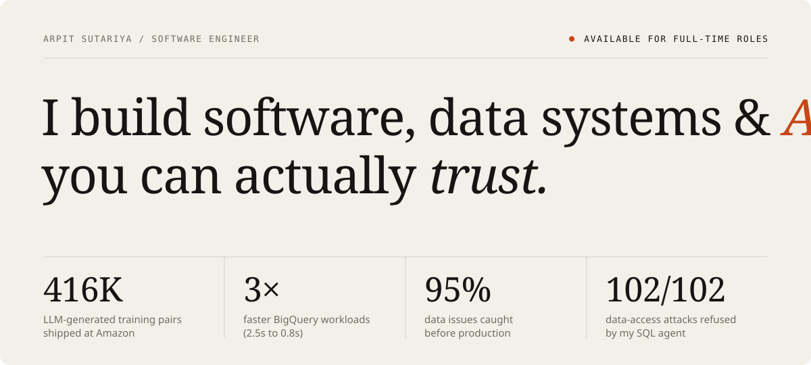

<picture>
  <source media="(prefers-color-scheme: dark)" srcset="assets/banner-dark.svg">
  
</picture>

  <a href="https://portfolio-five-xi-m41e5p3qbh.vercel.app"><b>Portfolio</b></a> &nbsp;·&nbsp;
  <a href="https://www.linkedin.com/in/arpit-sutariya-6194a5223/">LinkedIn</a> &nbsp;·&nbsp;
  <a href="mailto:arpitsutariya13@gmail.com">arpitsutariya13@gmail.com</a> &nbsp;·&nbsp;
  Los Angeles

 

Hi, I'm Arpit, a software engineer finishing my M.S. in Applied Data Science at USC. I work across the stack, from backend services and data pipelines to machine learning models and LLM agents. Most of the projects below come with tests, a reproducible eval, and a short section on what still doesn't work.

 

### `(01)` &nbsp;Selected work: AI agents

| | What it does | Measured |
|:--|:--|:--|
| **[Incident Copilot](https://github.com/arpit-sutariya/incident-copilot)** | On-call agent that investigates logs, metrics, and deploys, proposes one allowlisted fix, waits for approval, then verifies recovery on real traffic | 20/24 incidents fixed · 4/4 wrong fixes caught |
| **[Scoped SQL Agent](https://github.com/arpit-sutariya/scoped-sql-agent)** | Plain-English analytics over messy ERP, CRM, and support data, with per-user permissions enforced by the database itself. MCP server for Claude Desktop | 102/102 attacks refused · 0 values leaked |
| **[Event Prep Agent](https://github.com/arpit-sutariya/event-prep-agent)** | One sentence in, an approved calendar and email plan out. LangGraph state survives a crash at any step | 300 chaos runs · 0 duplicate emails |
| **[Invoice Agent](https://github.com/arpit-sutariya/invoice-agent)** | Matches supplier invoices to purchase orders, auto-approves clean ones, routes exceptions to a reviewer. FastAPI + React | 100/100 correct · 0 false approvals |
| **[Store Assistant](https://github.com/arpit-sutariya/store-agent)** | Shopping and support agent with hybrid search, photo search (CLIP), and returns the customer confirms | 40/40 relevant result first |
| **[Home Repair Check](https://github.com/arpit-sutariya/home-repair-check)** | Photo-based home repair triage: likely issue, urgency, cost range, quote check, real local pros | 81% photo · 92% text accuracy |

### `(02)` &nbsp;Data & earlier work

- **[ChatMyDB](https://github.com/arpit-sutariya/chatdb21)**: NL-to-SQL across PostgreSQL and MongoDB, 92% first-pass accuracy
- **[OpsBrainLLM](https://github.com/arpit-sutariya/opsbrainLLM)**: five LangGraph agents for manufacturing analytics
- **[Code Review Bot](https://github.com/arpit-sutariya/code-review-bot)**: PR reviews from GitHub Actions
- **[Codeflow](https://github.com/arpit-sutariya/codeflow)**: real-time collaborative editor (OT)
- **[GymAI](https://github.com/arpit-sutariya/GymAI-Intelligent-Gym-Trainer)**: pose estimation and rep counting
- **[Autopilot](https://github.com/arpit-sutariya/autopilot)**: YOLOv7 + MiDaS perception with A\* path planning

 

### `(03)` &nbsp;Experience

| Where | Role | When |
|:--|:--|:--|
| **Amazon**  Amazon Music · San Francisco | Software Engineering Intern  Mined search logs with PySpark on EMR and built an LLM training-data pipeline on Bedrock (416K pairs) to fine-tune a sparse retrieval encoder | May – Aug 2026 |
| **USC Viterbi**  Los Angeles | Graduate Research Assistant  Cut BigQuery latency from 2.5s to 0.8s; built ETL for 50K documents and an agentic LangGraph workflow | Aug 2025 – Apr 2026 |
| **RelTime**  Mumbai | Data Scientist Intern  Data quality framework that caught 95% of issues before production; Tableau and Power BI on a star schema | May – Aug 2024 |

 

### `(04)` &nbsp;Toolkit

**Languages** &nbsp; Python · SQL · Java · Scala · JavaScript · C/C++ · Bash  
**Data** &nbsp; Spark / PySpark · Airflow · dbt · Kafka · Redshift · Snowflake · BigQuery · PostgreSQL  
**Cloud** &nbsp; AWS (EMR, Glue, Kinesis, Lambda, Athena, Bedrock, SageMaker) · Docker · Kubernetes · GitHub Actions  
**AI / ML** &nbsp; LangGraph · LangChain · Claude API · MCP · RAG · FAISS · OpenSearch · PyTorch · scikit-learn

 

  M.S. Applied Data Science, University of Southern California · graduating December 2026 · open to full-time roles in software, data, and ML

